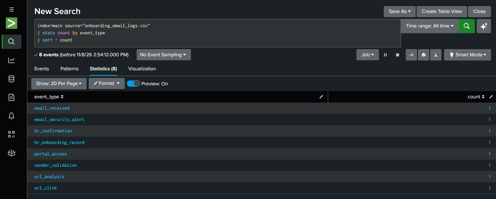
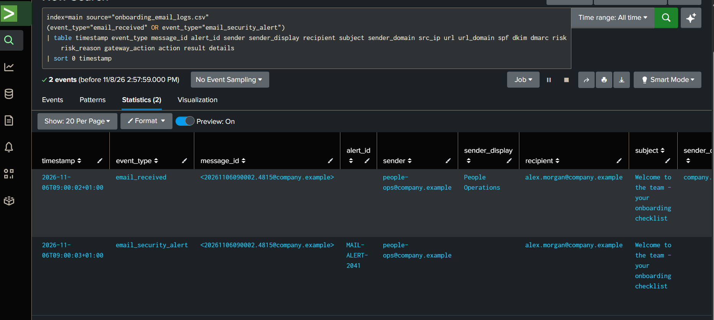

# Email Security Alert Investigation — SOC L1

**Project type:** Simulated Blue Team investigation  
**Status:** In progress  
**Dataset:** [`data/onboarding_email_logs.csv`](data/onboarding_email_logs.csv)  
**Environment:** Splunk Enterprise


## 1. Initial Event Overview

**Objective:** Review the available security events and establish the scope of the email security investigation.

**Executed SPL:**

```spl
index=main source="onboarding_email_logs.csv"
| stats count by event_type
| sort - count
```



**Results:**

The search returned 8 events, with one event recorded for each of the following event types:

| Event type | Count |
|---|---:|
| email_received | 1 |
| email_security_alert | 1 |
| hr_confirmation | 1 |
| hr_onboarding_record | 1 |
| portal_access | 1 |
| sender_validation | 1 |
| url_analysis | 1 |
| url_click | 1 |

**Analysis:**

The dataset contains a complete sequence of events related to one email security alert.

The message was received, an automated security alert was generated, and further events were recorded for sender validation, URL analysis, recipient interaction and HR confirmation.

These events provide several investigation paths that can help determine whether the alert represents a genuine phishing threat or a legitimate business communication.

**Preliminary assessment:** Further investigation required. No final classification has been made.


## 2. Email and Security Alert Analysis

**Objective:** Examine the original email and the associated security alert to identify the reason for detection and review the available email metadata.

**Executed SPL:**

```spl
index=main source="onboarding_email_logs.csv"
(event_type="email_received" OR event_type="email_security_alert")
| table timestamp event_type message_id alert_id sender sender_display recipient subject sender_domain src_ip url url_domain spf dkim dmarc risk risk_reason gateway_action action result details
| sort 0 timestamp
```



**Results:**

The search returned 2 events associated with the same email message.

**Event 1 — Email received**

| Field | Value |
|---|---|
| Timestamp | 2026-11-06 09:00:02 +01:00 |
| Sender | `people-ops@company.example` |
| Sender display name | People Operations |
| Recipient | `alex.morgan@company.example` |
| Subject | Welcome to the team - your onboarding checklist |
| Message-ID | `<20261106090002.4815@company.example>` |
| Sender domain | `company.example` |
| Source IP | `192.0.2.25` |
| URL | `https://newstarter.company.example/welcome/checklist` |
| URL domain | `newstarter.company.example` |
| SPF | pass |
| DKIM | pass |
| DMARC | pass |
| Risk | medium |
| Gateway action | `delivered_with_alert` |
| Result | delivered |

**Event details:**

Welcome email delivered to a new employee. Automated email security detection raised a medium-risk alert because the URL had not previously been observed for this recipient.

**Event 2 — Email security alert**

| Field | Value |
|---|---|
| Timestamp | 2026-11-06 09:00:03 +01:00 |
| Alert ID | `MAIL-ALERT-2041` |
| Sender | `people-ops@company.example` |
| Recipient | `alex.morgan@company.example` |
| Subject | Welcome to the team - your onboarding checklist |
| Risk | medium |
| Risk reason | First-seen URL for this recipient; reputation not yet established |
| Action | `alert_generated` |
| Result | `potential_phishing_detection` |

**Alert details:**

Automated rule matched: `URL_FIRST_SEEN_FOR_RECIPIENT`. Message was delivered with a medium-risk alert; it was not blocked or quarantined.

**Analysis:**

The email security system generated a medium-risk alert because the URL was being observed for the first time for this particular recipient.

The available email metadata shows several potentially legitimate indicators:
- The sender uses the `company.example` domain.
- The sender display name identifies People Operations.
- SPF, DKIM and DMARC authentication checks all passed.
- The URL uses a subdomain of `company.example`.
- The subject and URL path refer to employee onboarding.

However, these indicators alone are not sufficient to establish that the message is legitimate.

The email was delivered with an alert rather than blocked or quarantined.

**Preliminary assessment:** Potential false positive. Further investigation is required to independently verify the sender, URL and HR onboarding activity before closing the alert.
